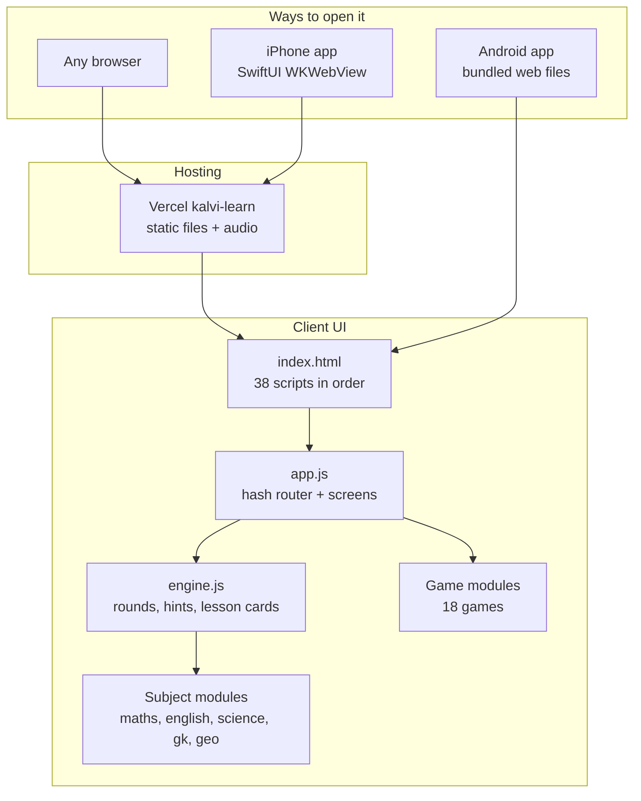
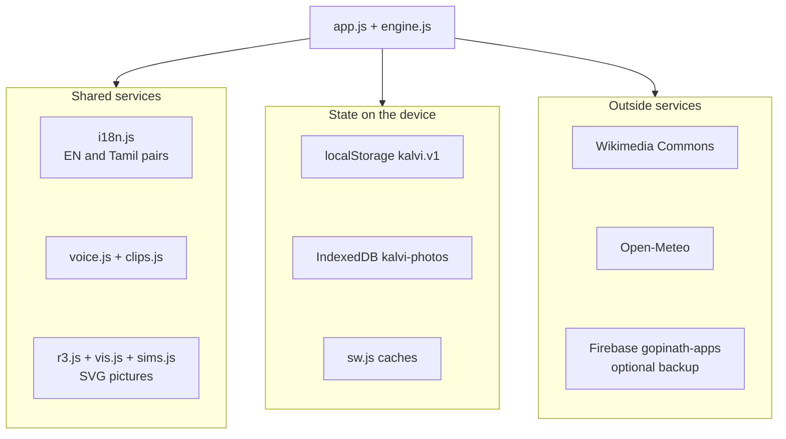
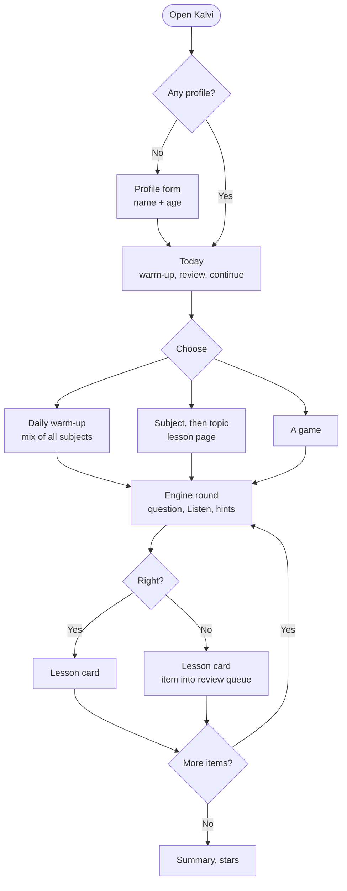
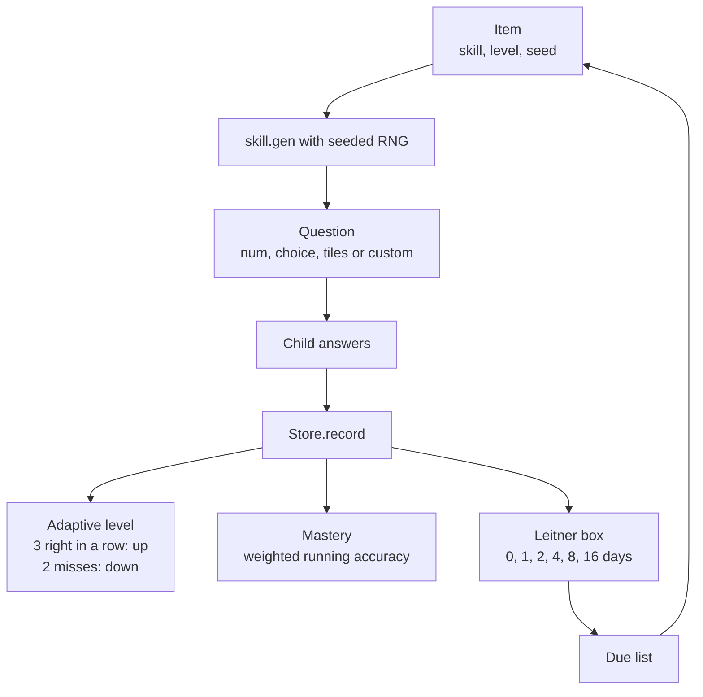
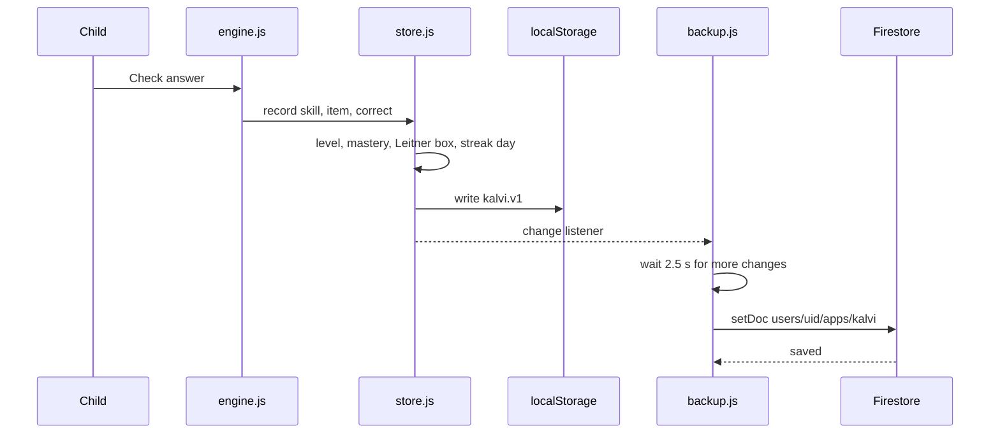
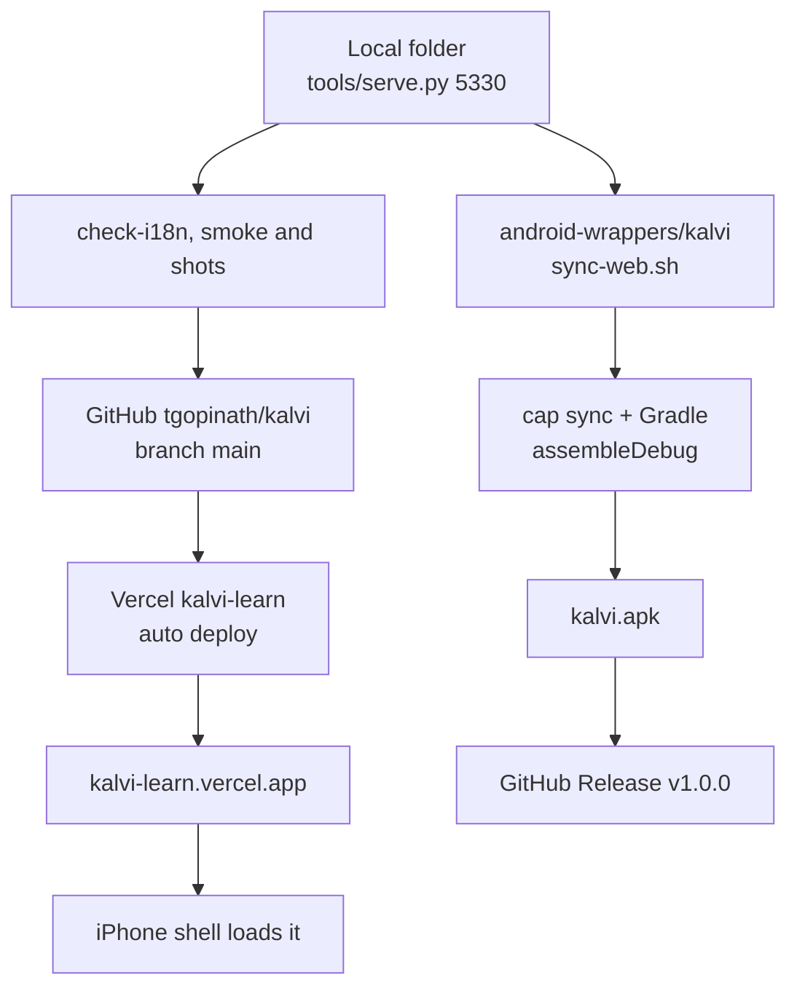

# Kalvi (கல்வி): architecture

Kalvi is a calm learning app for children aged 3 to 10, with Maths, English, Science and World, and the whole interface in English or Tamil. The main idea is one shared practice engine: every question is generated from a skill, a level and a seed, every answer is followed by a lesson card, and every miss goes into a spaced review queue. Eighteen games and four subjects plug into that engine through a small module contract. There is no build step and no backend of its own. Progress stays on the device, with an optional Google backup for grown-ups on the web.

| Platforms | Stack | Data | Hosting |
| --- | --- | --- | --- |
| Web PWA, Android (bundled Capacitor app, works offline), iPhone (SwiftUI WKWebView shell) | Plain HTML, CSS and JavaScript (38 IIFE modules plus one ES module), Kolam design system, no framework | 180 generated skills, 3,251 recorded voice clips, vetted Wikimedia photos, bundled TopoJSON maps | Vercel project `kalvi-learn`, static files, deployed on every push to `main` |

## System architecture

`index.html` loads the Kolam stylesheets (local copies in `kolam/`), one CSS file per game, and 38 classic scripts in a fixed order. Each script is an IIFE that sets one global, such as `I18N`, `Store`, `Engine` or `MATHS`. `app.js` is the shell: it owns the hash router, the header, the subject pages and the Grown-ups area. The last script, `backup.js`, is the only ES module, because it imports the shared Firebase config.

*One static site. The iPhone app loads the live URL; the Android app ships the same files inside the APK.*

Around the engine sit the services every module shares: strings, storage, voice, photos and the 3D renderer. Only three things leave the device: Wikimedia images and clips, one Open-Meteo weather call, and the optional Firebase backup.

*Shared services, device state and the three outside services.*

## Main user flow

The core job is a short daily practice round. On first run there is no profile, so the router sends the child (or a grown-up) to the profile form, which asks for a name and an age. The age picks a row in the per-year table in `age.js`: how many answer choices to show, how long a round is, whether text is read aloud automatically, and which topics are open.

*Every route to practice ends in the same engine round.*

A topic round has 5 to 10 items depending on age. `mix()` in `app.js` puts up to two due reviews from the topic first, then picks skills weighted towards low mastery, and slips in one item from another topic the child has already practised. The warm-up takes one or two items from each subject, including any due review.

### The practice engine

The distinctive mechanism is that questions are not stored, they are generated. A skill is registered with `Engine.skill({ id, subject, topic, bands, gen })`. `gen(level, rng)` gets a seeded random generator (xorshift in `engine.js`), so the same skill, level and seed always gives the same question. That is what lets the review queue keep only `{skill, lvl, seed}` for a missed item and rebuild the exact question days later.

*The loop that makes review possible without storing any question text.*

Mastery moves further on harder levels (the weight is 0.25 plus 0.1 per level above 1). A skill counts as mastered at 85% mastery with at least 8 answers. A miss puts the item into box 0, due today; each later right answer moves it up a box, and it leaves the queue after the last box.

## Data flow and state

Everything a child does is written to one localStorage key, `kalvi.v1`, through `Store.save()`. Store listeners fire on every save, and that is the only hook the backup needs. The sequence below shows an answer being saved while a grown-up has Google backup switched on in the web app.

*Backup is a debounced copy of the whole store. Children never see a sign-in.*

On the first sign-in, `backup.js` reads the cloud copy and calls `Store.mergeIn()`. Profiles are matched by id and the one with the newer `updated` time wins, so two devices can be merged without losing a child.

| Where | What lives there |
| --- | --- |
| `localStorage kalvi.v1` | All profiles: name, age, band, colour, per-subject skills (level, mastery, counts), review queue, lessons seen, practice days, last 60 sessions, settings, and small per-module extras such as stickers and the lab notebook |
| `localStorage kalvi.lang`, `kalvi.sound`, `kalvi.mani`, `kalvi.vid.cc` | Language, sound on or off, the Mani narrator on or off, video caption preference |
| `localStorage kalvi.backup`, `kalvi.backupPhotos` | Whether Google backup was turned on, and whether profile photos are included (off by default) |
| `IndexedDB kalvi-photos` | Profile photos a grown-up adds; they stay on the device unless photo backup is switched on |
| Service worker caches | `kalvi-shell-v2-ios` for app files (network first), `kalvi-img-v1` for Wikimedia images (cache first) |
| Firestore `users/{uid}/apps/kalvi` | Optional: the whole store as one JSON string plus `updatedAt`; web only |
| Memory only | The current round, the Grown-ups unlock time (10 minutes) |

## Key modules

| File / module | Responsibility |
| --- | --- |
| `js/app.js` | Hash router (`#/`, `#/s/subject`, `#/t/subject/topic`, `#/round`, `#/progress`, `#/parent`, `#/profile`, plus module routes), header, Today, subject and topic pages, round mixing, Grown-ups gate, Android and iOS bar sync |
| `js/engine.js` | Skill registry (`Engine.SK`), seeded RNG, adaptive item picking, round UI, three-step hint ladder, lesson card after every answer, summary |
| `js/store.js` | The one localStorage document, profiles, levels, mastery, Leitner queue, streaks, export and merge |
| `js/age.js` | Per-year table for ages 3 to 10 (choices, round length, auto-listen, break reminders) and the minimum age for each topic |
| `js/i18n.js` | Every visible string as an `[English, Tamil]` pair; modules add their own with `I18N.add` |
| `js/voice.js`, `js/clips.js` | Listen button: plays a recorded clip if one exists for that exact line, otherwise device speech |
| `js/maths.js`, `english.js`, `science.js`, `gk.js`, `geo.js` | Topics and skill generators for the four subjects (58 maths, 51 English, 59 science, 12 world skills) |
| Game modules | Maths quiz, puzzles, coding, English quiz, stories, spelling bee, word puzzles, typing, science quiz, science puzzles, videos, lab, Earth and places, GK, daily GK, memory, drawing, music |
| `js/r3.js`, `vis.js`, `sims.js` | A tiny orthographic 3D renderer that outputs SVG, maths visuals (ten frames, number lines, clocks, money), and 11 interactive science demos |
| `js/play.js` | Sound palette, stars, stickers and the Mani narrator; all optional |
| `js/photo.js`, `photos.js`, `pics.js`, `photo-wire.js` | Profile photos in IndexedDB, and the vetted photo sets with credits, attached to lesson cards |
| `js/backup.js` | Optional Google backup with Firebase Auth and Firestore, loaded from the gstatic CDN only when used |
| `sw.js` | Offline cache for the web app |
| `tools/` | Node and Python helpers: voice recording, photo vetting and bundling, map building, string check, smoke tests, screenshots, contrast check |

The module contract is written down in `docs/MODULES.md`, so a new game only needs to register skills, optionally a route, and a `game` object that the subject page lists.

## Platforms

### Web (PWA)

In any browser Kalvi keeps its Kolam look: Lato, hairline borders, a dark art board for visuals, and a side or bottom navigation. It installs as a PWA from `manifest.json`, and the service worker registers only over https.

### Android

The Android app (`com.gopinath.kalvi`) is a **bundled** Capacitor 8 shell in `android-wrappers/kalvi`. `sync-web.sh` copies the web folder into `www/` (leaving out tools, docs, the service worker and prototypes), keeps only the 1,001 most-used voice clips, runs `cap sync` and builds the APK. Other clips stream from the live site when online. Inside the app the Kolam M3 kit adds `html.k-android` and the page follows Material Design 3: a top app bar with Back, a five-item navigation bar (Today, Maths, English, Science, World) and Tamil labels that fit. Google backup is turned off here and the card says it is web only.

### iPhone

The iPhone app (`Kalvi-iOS`) is a SwiftUI shell with one WKWebView that loads `https://kalvi-learn.vercel.app/`. It adds `Kalvi-iOS` and `Kolam-iOS` to the user agent and injects `window.KolamShell`, so the Kolam iOS kit sets `html.k-ios` and the page follows Apple's Human Interface Guidelines: large titles, a five-tab bar, Back with a centred title. The shell also handles haptics sent from the page, opens outside links in Safari's viewer, turns JavaScript alerts into iOS alerts, and shows an offline screen with Try Again. It is set to the light appearance.

Both kits are local copies inside `kolam/m3` and `kolam/ios`, so the bundled Android app works without reaching GitHub Pages. `?app=android`, `?app=ios` and `?app=web` force a look for testing.

## Data sources and APIs

| Source | Used for | Licence / key |
| --- | --- | --- |
| Wikipedia and Wikimedia Commons | Vocabulary photos (86 in `PICS`), science, world and maths photos (110 in `PHOTOS`), bundled as 480 px WebP; a short list of real video clips streamed from Commons | CC or public domain, credit kept per file; no key |
| datameet (Survey of India boundaries) | India states and Tamil Nadu districts in `data/geo/` | CC BY 4.0 |
| Natural Earth, OpenStreetMap | World countries and rivers in `data/geo/` | Public domain; ODbL |
| Open-Meteo forecast API | Current weather in Chennai on the weather science page | Free, no key |
| macOS voices Tara (en_IN) and Vani (ta_IN) | 3,251 recorded clips in `audio/`, made by `tools/voice.mjs` | Recorded locally |
| Firebase `gopinath-apps` | Optional Google sign-in and Firestore backup (config from Kolam Auth) | Public web config, no secrets in the repo |
| Fluent Emoji 3D | Subject and topic icons in `img/icons/` | MIT |
| Lato, Noto Sans Tamil | Bundled fonts in `fonts/` | SIL OFL |

The question banks are written by hand in the modules. The GK questions in `gk-data.js` each carry a source note and the month they were checked.

## Offline, performance, privacy and accessibility

**Offline.** The web service worker caches app files as they are fetched (network first, cache fallback) and Wikimedia images on first view. The Android app is fully offline apart from voice clips outside the bundled set, which fall back to device speech.

**Performance.** There is no framework and no build. Pictures are drawn as SVG by `r3.js` and `vis.js` instead of loaded as images. Voice clips are AAC mono at 16 kbps and load one at a time. The Firebase SDK is imported only when a grown-up uses backup.

**Privacy.** No account is needed and children never see a sign-in. Profiles and photos stay on the device. The Grown-ups area is behind a simple sum and locks again after 10 minutes. Backup is opt-in, web only, and photos are excluded unless a grown-up turns them on.

**Accessibility.** The module contract asks for 48 px targets, keyboard and screen-reader support, `aria-live` feedback and `prefers-reduced-motion`. There is a skip link, every prompt has a Listen button, and Tamil text uses Noto Sans Tamil. `tools/check-i18n.mjs` checks that every string has both languages and `tools/contrast.mjs` checks colours.

## Build and deploy

*The website and iPhone app update on every push to main. The APK has to be rebuilt and uploaded by hand.*

There is nothing to compile for the web app. Content tools run on a developer machine and write their results into the repo: `voice.mjs` records new or changed lines with the macOS `say` command, `bundle-photos.mjs` turns vetted photos into WebP, and `build-geo.sh` runs mapshaper to make the TopoJSON maps. `vercel.json` only sets `Cache-Control: no-cache` on `sw.js`.

## Known limits and next steps

- Google backup depends on `kalvi-learn.vercel.app` being in the Firebase authorized domains. Not verified from code whether that is done; the app shows a clear error if it is not.
- Backup is a whole-document copy with newest-profile-wins merging, so two devices changing the same child at once keep only the newer copy.
- The Android APK is a debug build and is updated by hand, so it can fall behind the website.
- Tamil device speech is not available on every device; recorded clips cover fixed lines, and generated lines without a clip are skipped with a notice in Tamil mode.
- A larger visual redesign is in progress on a separate branch (`ui-redo`); this document describes `main`.

---

Written from the source code on 17 November 2026. Source: [github.com/tgopinath/kalvi](https://github.com/tgopinath/kalvi)
